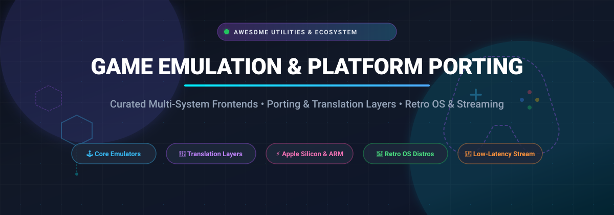

# Awesome-Game-Emulation-Platform-Porting-Utilities

  

  
  
  
  
  

---

# 🕹️ Top Game Emulation & Platform Porting Utilities

> **The definitive directory of SaaS cloud-gaming platforms, cross-platform binary translation layers, flagship console emulators, retro OS distributions, and low-latency game streaming servers.**

🎮 **Keywords**: *game emulation, video game preservation, platform porting utilities, Wine, Proton, DXVK, Apple Silicon gaming, Box64, FEX-Emu, RetroArch, RPCS3, shadPS4, PCSX2, Dolphin, Sunshine, Moonlight, Batocera, cloud gaming.*

---

## 📑 Table of Contents
- [🔍 Introduction & Scope](#-introduction--scope)
- [📊 Sector Overview & Market Dynamics](#-sector-overview--market-dynamics)
- [☁️ SaaS/Hosted & Commercial Platforms](#️-saashosted--commercial-platforms)
- [💻 Open-Source GitHub Projects](#-open-source-github-projects)
  - [⚡ Top Open-Source Projects (Ranked by Stars)](#-top-open-source-projects-ranked-by-stars)
- [🌟 Star History](#-star-history)
- [🛠️ How to Contribute](#️-how-to-contribute)
- [⚠️ Disclaimer](#️-disclaimer)
- [💖 Support & Thank You](#-support--thank-you)

---

## 🔍 Introduction & Scope

Welcome to **Awesome Game Emulation & Platform Porting Utilities**! This curated repository tracks the leading **commercial cloud-gaming services** and top **open-source emulator and translation engines**. Whether you are gaming on **macOS Apple Silicon (M1/M2/M3/M4)**, configuring a **Steam Deck / Linux handheld**, running **arcade & retro preservation cabinets**, or streaming 4K HDR PC games across your home network with near-zero latency, these utilities represent the state of the art in video game virtualization and portability.

✨ **Key Highlights**:
- 🚀 **Next-Gen Compatibility**: Binary translation engines (`Box64`, `FEX-Emu`, `Proton`, `DXVK`, `Whisky`, `NX2Apple`) bringing x86/x64 and console titles seamlessly to ARM64 and macOS.
- 🕹️ **Flagship Emulators**: High-accuracy emulators for PlayStation (`shadPS4`, `RPCS3`, `PCSX2`), Nintendo (`Dolphin`, `melonDS`), Sega (`Flycast`), and Arcade (`MAME`).
- 📺 **Zero-Latency Streaming**: Open-source host/client ecosystems (`Sunshine` + `Moonlight`) outperforming proprietary remote desktop solutions.
- 💾 **Turnkey Retro OS**: Dedicated, driver-optimized bootable operating systems (`Batocera.linux`, `Recalbox`, `RetroPie`).

---

## 📊 Sector Overview & Market Dynamics

The global Cloud Gaming, Retro Emulation & Cross-Platform Game Porting market is valued at approximately **$9.5B–$12.8B+ in 2026**, expanding at a ~20%–26% CAGR propelled by handheld Linux/ARM gaming PCs (Steam Deck, ROG Ally), Apple Silicon native/translation gaming, and official retro preservation storefronts. 

The commercial cloud-streaming layer exhibits **strong winner-take-most consolidation** around NVIDIA GeForce NOW, Xbox Cloud Gaming, and European leaders like Boosteroid and Shadow PC, whereas the emulation, OS-distro, and binary-translation layers are **overwhelmingly powered by open-source community projects** (`RetroArch`, `Wine/Proton`, `DXVK`, `Box64`, `Batocera`, `Sunshine/Moonlight`).

---

## ☁️ SaaS/Hosted & Commercial Platforms

*Sorted descending by company valuation / annual revenue scale.*

| 🏷️ Platform | 📝 Description | 🏢 Company Scale (Valuation / Revenue) | 💳 Starting Paid Tier | 🎁 Free Tier / Trial Limit |
| :--- | :--- | :--- | :--- | :--- |
| **[GeForce NOW (NVIDIA)](https://nvidia.com)** | Cloud RTX game-streaming platform running PC libraries from Steam, Epic, Xbox, and GOG on low-power laptops, macOS, Linux, and handhelds. | **Part of NVIDIA Corp.** (~$130B+ annual revenue; ~$3T+ market cap) | **$9.99 / month** ($49.99/6 mos Performance) or **$19.99 / month** ($99.99/6 mos Ultimate RTX 4080/5080) | **Forever Free Basic Tier** (Ad-supported **1-hour session limit** with standard queue access and basic cloud rig) |
| **[Shadow PC (OVHcloud / Octave Klaba)](https://shadow.tech)** | Full cloud Windows 11 gaming and workstation PC streamed at low latency to macOS, Linux, Android, iOS, and smart TVs for running any emulator or PC game. | **Backed by Octave Klaba / OVHcloud** (~€1B+ OVHcloud group revenue) | **$19.99 / month** (Discovery tier) or **$32.99 – $49.99 / month** (Boost / Power RTX GPU tiers) | **No Perpetual Free Tier** (Occasional promo discount first-month trials; full Windows cloud VM requires active monthly subscription) |
| **[Boosteroid](https://boosteroid.com)** | Leading European independent cloud gaming platform streaming AAA and indie PC titles at up to 4K/120fps across browsers, Linux, macOS, and TVs. | **~$100M–$200M Est. Valuation** (~$20M–$40M est. ARR; rapid EU/US server expansion) | **€7.49 / month** billed annually (€89.89/yr) or **€9.89 / month** monthly for Ultra 4K | **No Perpetual Free Tier** (Free account allows latency/bitrate connection testing before purchasing a monthly/annual pass) |
| **[Antstream Arcade](https://antstream.com)** | Official cloud retro-gaming platform streaming 1,300+ licensed arcade, Commodore, Amiga, SNES, and PlayStation classics with cloud saves and tournaments. | **~$30M–$50M Est. Valuation** (~$5M–$10M est. ARR; $20M+ VC funding) | **$3.99 / month** ($39.99/yr annual subscription) or **$99.99 one-time** Lifetime pass | **Forever Free Ad-Supported Tier** (Free retro game play supported by pre-roll ads and tournament gems; 7-day full trial on select platforms) |
| **[Utomik](https://utomik.com)** | Subscription cloud and fast-chunked-download PC/retro gaming platform curating 1,400+ indie, classic, and family titles on PC and smart TVs. | **~$15M–$30M Est. Valuation** (~$5M+ est. ARR; Dutch cloud-gaming company) | **$8.99 / month** for PC plan or **$11.99 / month** for PC + Cloud TV plan | **14-Day Free Trial** (Unlimited access to the 1,400+ game catalog during the 14-day evaluation period; no perpetual free tier) |
| **[LaunchBox / Big Box (Unbroken Software)](https://launchbox-app.com)** | Premier Windows/Android retro-game launcher, metadata scraper, and 10-foot arcade cabinet frontend ("Big Box") integrating RetroArch and standalone emulators. | **~$5M–$15M Est. Scale** (Profitable independent US retro-gaming software company) | **$30 / year** (1-year updates) or **$75 one-time** Forever Updates license for Big Box mode | **Forever Free LaunchBox Desktop** (100% free desktop game library organizer, emulator launcher, and metadata/box-art scraper forever) |
| **[RetroArch (Libretro Cloud / Store Ecosystem)](https://retroarch.com)** | Cross-platform frontend for the Libretro API running hundreds of open-source emulator cores with netplay, shaders, and Steam/App Store cloud saves. | **Non-Profit / Community Open-Source Project** (Patreon & bounty funded) | **$0 / Free Open-Source** (Optional Patreon tiers for buildbot infrastructure support) | **100% Free Forever** (Available free across Windows, macOS, Linux, iOS/tvOS App Store, Android, Steam, and consoles) |
| **[Playnite (Hosted Addon & Metadata Ecosystem)](https://playnite.link)** | Open-source unified PC and console-emulator library manager with hosted plugin/theme repositories and full-screen controller UI. | **Community Open-Source Project** (Maintained by Josef Nemec & contributors) | **$0 / Free Open-Source** (Optional Patreon sponsorship) | **100% Free Forever** (MIT-licensed unified launcher integrating Steam, Epic, GOG, Xbox, and 50+ emulators with zero ads) |
| **[Batocera.linux (Hosted OS & Content Ecosystem)](https://batocera.org)** | Plug-and-play retro-gaming Linux OS distribution with hosted theme/bezel repositories and zero-config support for x86_64, Raspberry Pi, and ARM handhelds. | **Community Open-Source Project** (Donation & OpenCollective funded) | **$0 / Free Open-Source** (100% free downloadable bootable OS images) | **100% Free Forever** (Unlimited USB/SD live-boot retro console OS with 150+ pre-configured emulators and shaders) |
| **[Recalbox (Commercial Hardware / RGB Dual Ecosystem)](https://recalbox.com)** | User-friendly open-source retro-gaming OS paired with official Recalbox RGB Dual CRT hardware adapters, pre-flashed kits, and Patreon early builds. | **~$2M–$5M Est. Scale** (French retro-gaming hardware & open-source software organization) | **$0 / Free OS** (Official Recalbox RGB Dual/JAMMA CRT hardware kits from **€39–€89**) | **100% Free Forever OS** (Free downloadable OS images for Raspberry Pi, PC, and handhelds with built-in Kodi and netplay) |

---

## 💻 Open-Source GitHub Projects

### ⚡ Top Open-Source Projects (Ranked by Stars)

*All open-source tools below are actively maintained community software. Sorted strictly descending by GitHub star count.*

| 📦 Repository & Project | ⭐ GitHub Stars | 📜 License | 🎯 Category & Description |
| :--- | :--- | :--- | :--- |
| **[Sunshine](https://github.com/SunshineStream/Sunshine)** |  | GPL-3.0 | 📡 **Low-Latency Streaming Server** — Self-hosted low-latency game stream host for Moonlight supporting Windows, Linux, and macOS with hardware GPU encoding. |
| **[shadPS4](https://github.com/shadps4-emu/shadPS4)** |  | GPL-2.0 | 🎮 **PlayStation 4 Emulator** — High-performance PlayStation 4 emulator written in C++ for Windows, Linux, macOS, and FreeBSD capable of booting 3D AAA commercial titles. |
| **[Proton](https://github.com/ValveSoftware/Proton)** |  | Proprietary / BSD / LGPL | 🍷 **Gaming Compatibility Layer** — Valve's compatibility tool for Steam Play based on Wine and DXVK/VKD3D to seamlessly run Windows games on Linux and Steam Deck. |
| **[RPCS3](https://github.com/RPCS3/rpcs3)** |  | GPL-2.0 | 🎮 **PlayStation 3 Emulator** — Open-source Sony PlayStation 3 emulator and debugger written in C++ for Windows, Linux, macOS, and FreeBSD with high compatibility. |
| **[Moonlight Qt](https://github.com/moonlight-stream/moonlight-qt)** |  | GPL-3.0 | 📡 **GameStream Client** — High-performance open-source client for Sunshine and NVIDIA GameStream supporting 4K, 120 FPS, and HDR across Windows, macOS, Linux, and Steam Link. |
| **[DXVK](https://github.com/doitsujin/dxvk)** |  | zlib | ⚡ **D3D to Vulkan Translation** — Vulkan-based translation layer for Direct3D 8, 9, 10, and 11 running on Linux / Wine for massive performance gains. |
| **[OpenEmu](https://github.com/OpenEmu/OpenEmu)** |  | BSD-2-Clause | 🍎 **macOS Emulation Frontend** — Elegant modular retro video game emulation environment tailored specifically for macOS with plug-and-play controller mapping. |
| **[PCSX2](https://github.com/PCSX2/pcsx2)** |  | GPL-3.0 | 🎮 **PlayStation 2 Emulator** — The definitive PlayStation 2 console emulator for Windows, Linux, and macOS with modern Vulkan rendering and widescreen patches. |
| **[Dolphin](https://github.com/dolphin-emu/dolphin)** |  | GPL-2.0 | 🐬 **GameCube & Wii Emulator** — Flagship GameCube and Nintendo Wii emulator allowing enhancements such as 4K resolution, HD texture packs, and netplay. |
| **[Whisky](https://github.com/Whisky-App/Whisky)** |  | GPL-3.0 | 🍏 **macOS Apple Silicon Porting Wrapper** — Clean and modern Wine wrapper for macOS built natively with SwiftUI and Apple's Game Porting Toolkit (GPTK). |
| **[PPSSPP](https://github.com/hrydgard/ppsspp)** |  | GPL-2.0 | 🎮 **PSP Emulator** — Fast portable PlayStation Portable emulator running full HD on Android, Windows, macOS, Linux, iOS, and Raspberry Pi. |
| **[RetroArch](https://github.com/libretro/RetroArch)** |  | GPL-3.0 | 🕹️ **Libretro Multi-System Frontend** — Universal multi-system emulation frontend powering hundreds of Libretro cores, real-time rewind, netplay, and CRT shaders. |
| **[Playnite](https://github.com/JosefNemec/Playnite)** |  | MIT | 🗃️ **Unified Game Launcher** — Open-source video game library manager supporting Steam, Epic, GOG, and 50+ console emulators with a couch-friendly Fullscreen mode. |
| **[RomM](https://github.com/rommapp/romm)** |  | AGPL-3.0 | 📦 **Self-Hosted ROM Management** — Self-hosted web ROM manager and player with automated IGDB metadata scraping, saves synchronization, and in-browser emulation. |
| **[MAME](https://github.com/mamedev/mame)** |  | BSD-3-Clause / GPL | 🕹️ **Arcade & Vintage Computer Preservation** — Historical arcade and retro computer hardware emulation preservation project supporting tens of thousands of systems. |
| **[RetroPie-Setup](https://github.com/RetroPie/RetroPie-Setup)** |  | GPL-3.0 | 🍓 **Raspberry Pi Retro Suite** — Complete setup scripts turning a Raspberry Pi, ODroid, or PC into an all-in-one retro gaming center powered by EmulationStation & RetroArch. |
| **[NX2Apple](https://github.com/LNPANDY/NX2Apple)** |  | GPL-3.0 | 📱 **Switch to iOS/iPadOS Porting Tool** — One-click macOS GUI utility to package and run homebrew/Switch titles directly on iPhone and iPad without terminal commands. |
| **[FEX-Emu](https://github.com/FEX-Emu/FEX)** |  | MIT | ⚡ **Fast x86-64 User-Mode Emulator** — High-performance usermode x86 and x86-64 translation engine for Arm64 Linux, enabling desktop PC gaming on ARM devices. |
| **[Box64](https://github.com/ptitSeb/box64)** |  | MIT | 📦 **x86_64 to ARM64 Translator** — Linux userspace x86_64 emulator targeted at ARM64, RISC-V 64, and LoongArch devices with native library wrapping for gaming. |
| **[melonDS](https://github.com/melonDS-emu/melonDS)** |  | GPL-3.0 | 🎮 **Nintendo DS & DSi Emulator** — Fast, accurate Nintendo DS and DSi emulator supporting OpenGL upscaling, JIT compilation, and online Wi-Fi emulation. |
| **[xemu](https://github.com/xemu-project/xemu)** |  | GPL-2.0 | 💚 **Original Xbox Emulator** — Cross-platform low-level original Xbox console emulator for Windows, macOS, and Linux with internal resolution scaling and Xbox Live tunneling. |
| **[Batocera.linux](https://github.com/batocera-linux/batocera.linux)** |  | GPL-2.0 | 🐧 **Retro-Gaming Linux OS** — Dedicated bootable retro-gaming distribution supporting x86_64 PCs, handhelds, and single-board computers with 150+ emulators out of the box. |
| **[VKD3D-Proton](https://github.com/HansKristian-Work/vkd3d-proton)** |  | LGPL-2.1 | ⚡ **Direct3D 12 on Vulkan** — Valve-backed development fork of VKD3D powering Proton's Direct3D 12 implementation on Linux with high performance and ray tracing support. |
| **[ScummVM](https://github.com/scummvm/scummvm)** |  | GPL-3.0 | 🧙 **Classic Adventure Game Engine** — Re-implementation of classic point-and-click adventure and RPG game engines, running LucasArts, Sierra, and Westwood titles everywhere. |
| **[Flycast](https://github.com/flyinghead/flycast)** |  | GPL-2.0 | 🌀 **Dreamcast & Naomi Emulator** — Multiplatform Sega Dreamcast, Naomi, Naomi 2, and Atomiswave emulator with Vulkan, widescreen, and rollback netplay support. |
| **[Recalbox OS](https://github.com/recalbox/recalbox-os)** |  | GPL-2.0 | 🕹️ **Microcomputer Retro System** — Easy-to-use plug-and-play retro gaming OS tailored for Raspberry Pi, Odroid, and PC with CRT TV output support (RGB Dual). |

---

## 🌟 Star History

---

## 🛠️ How to Contribute

Contributions are warmly encouraged! Here is how you can help expand this resource:

1. 🍴 **Fork the repository** to your personal GitHub account.
2. 🌿 **Create a dedicated branch**: `git checkout -b add/new-emulator-or-utility`.
3. 📝 **Add verified software**: Include official documentation links, exact licensing details, starting prices/free tier limits, and realistic descriptions.
4. 🧪 **Check formatting**: Ensure markdown tables remain consistent and well-aligned.
5. 🚀 **Submit a Pull Request** with a brief summary of the project's features and status.

---

## ⚠️ Disclaimer

This list is curated for technical research, game preservation, and platform interoperability purposes. All trademarks, service marks, trade names, product names, and logos appearing on this site belong to their respective owners. Emulators and translation tools should only be used in full compliance with local copyright laws and licensing terms for software and BIOS/firmware assets that you legally own.

---

## 💖 Support & Thank You

A huge thank you to all open-source developers, emulation reverse-engineers, and digital preservationists who keep video game history alive across modern hardware! 🎮✨

If you find this repository helpful, please consider supporting the project:
- ⭐ **Star this repository** to help others discover it on GitHub!
- 🍴 **Fork and share** with fellow emulation and platform porting enthusiasts!
- ☕ **Buy me a coffee / Sponsor**: If you'd like to support ongoing curation and maintenance, visit the [GitHub Sponsors Dashboard](https://github.com/sponsors/ishandutta2007).
